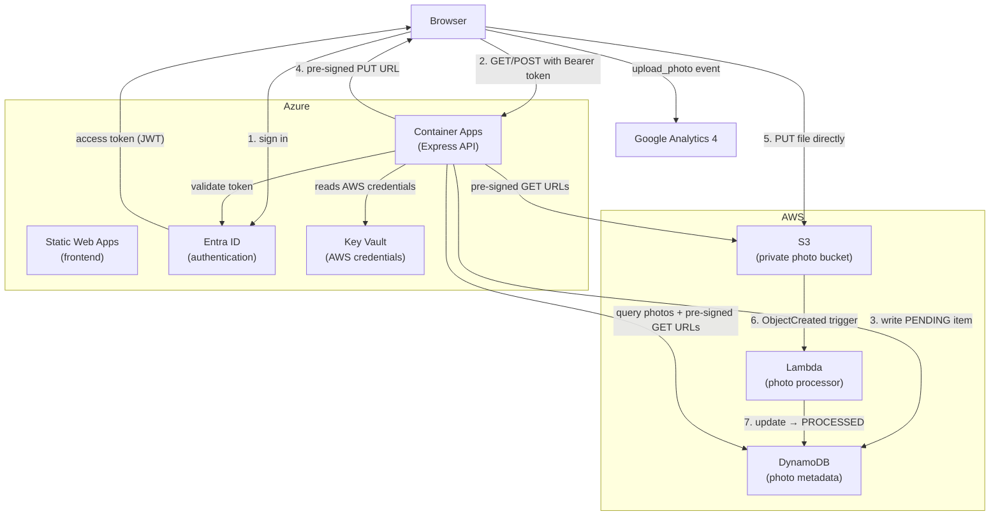
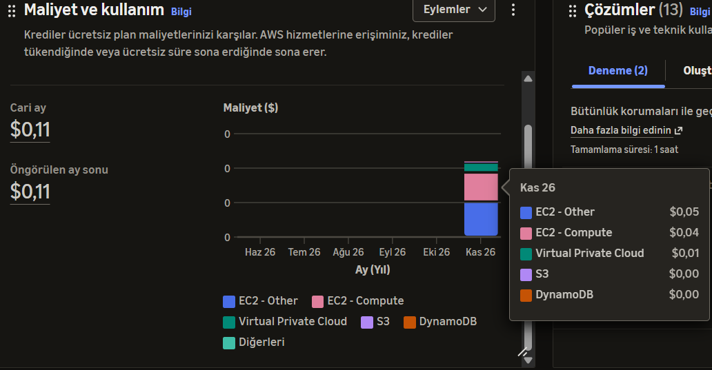
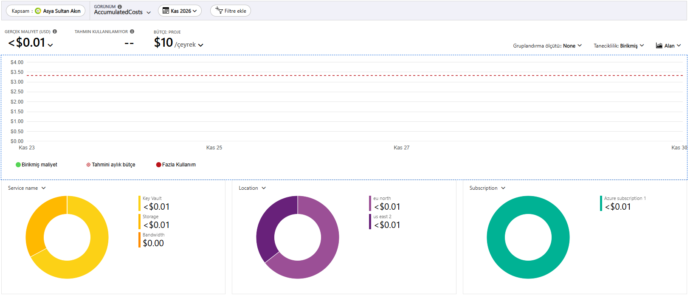

# CSE 415 Term Project — Multi-Cloud Photo Gallery

A photo gallery application deployed across Azure and AWS, built for CSE 415 Fundamentals of Cloud Computing.

## Architecture



| Component | Cloud | Service | Why |
|---|---|---|---|
| Web interface | Azure | Static Web Apps (Free) | Free HTTPS hosting, no server needed |
| Backend API | Azure | Container Apps (consumption) | Scales to zero; no App Service quota on this subscription |
| Authentication | Azure | Entra ID | Required; backend validates JWT on every request |
| Secrets | Azure | Key Vault (Standard, RBAC) | Stores the AWS access key; never in code or env files |
| Object storage | AWS | S3 (private bucket) | Required private bucket; browser uploads via pre-signed URL |
| Event function | AWS | Lambda (S3 ObjectCreated) | Required event trigger; flips photo status to PROCESSED |
| Database | AWS | DynamoDB (on-demand) | Serverless, always-free tier at this scale |
| Analytics | Frontend | Google Analytics 4 | Required; custom event `upload_photo` |
| IaC | GitHub | Terraform (remote state) | Required; one stack per cloud |
| CI/CD | GitHub | GitHub Actions (OIDC) | Required; no stored cloud credentials |

## How the two clouds talk

1. The browser signs in with Entra ID (MSAL) and gets a short-lived JWT access token.
2. Every API call sends the token as `Authorization: Bearer …`; the API validates it with `jose` (signature, issuer, audience, expiry).
3. `POST /api/photos/upload-url` — API writes a `PENDING` item to DynamoDB and returns a pre-signed S3 PUT URL (5-minute expiry).
4. The browser uploads the file **directly to S3** — the file never passes through the API.
5. S3 fires an `ObjectCreated` event → Lambda updates the DynamoDB item to `PROCESSED` with file size and timestamp.
6. `GET /api/photos` — API queries DynamoDB for the user's items and attaches pre-signed S3 GET URLs.

The API authenticates to AWS using an IAM access key stored in Key Vault and injected as Container App secrets at startup.

## Manual steps

The following steps were done by hand and are not managed by Terraform. Each entry explains why it cannot be automated.

| Step | Why it is manual |
|---|---|
| S3 state bucket `pgal-tfstate-asa` (eu-north-1, versioning on, encryption on, public access blocked) | Terraform cannot store its state in a bucket it has not created yet |
| Azure storage account `pgaltfstateasa`, resource group `pgal-tfstate-rg`, container `tfstate` (North Europe) | Same reason — state backend must exist before first `terraform init` |
| AWS IAM OIDC provider for `token.actions.githubusercontent.com` and role `pgal-github-actions` | The pipeline needs this trust to run; it cannot create its own credentials |
| Azure app registration `pgal-github-actions` with federated credentials, Contributor + User Access Administrator on subscription, Storage Blob Data Contributor on state container | Same reason — pipeline needs this trust before it can run; avoids giving Terraform directory write permissions |
| GitHub repository variables (`AWS_ROLE_ARN`, `AWS_REGION`, `AZURE_CLIENT_ID`, `AZURE_TENANT_ID`, `AZURE_SUBSCRIPTION_ID`, `AZURE_REGION`) | Public identifiers consumed by the pipeline |
| Entra SPA app registration `pgal-spa` (client ID `7e709590-8b26-4044-b0e2-f93fc367ceb9`): redirect URI `http://localhost:5173`, Application ID URI `api://7e709590-…`, scope `access_as_user`, token version 2 | Avoids giving the pipeline Microsoft Graph write permissions |
| GitHub repository variable `ENTRA_CLIENT_ID` | Public identifier for the SPA app, consumed by the pipeline to build `config.json` |
| After first deploy: add the Static Web App URL (`https://happy-smoke-080ef890f3.azurestaticapps.net`) as a redirect URI in the `pgal-spa` app registration | URL is not known until Terraform runs |
| Register `Microsoft.App` resource provider on the Azure subscription (Portal → Subscriptions → Resource providers) | Required for Container Apps; not registerable via Terraform before first use |
| GA4 property `pgal-photo-gallery`, web data stream for `https://happy-smoke-080ef890f3.azurestaticapps.net`, measurement ID `G-1P3E9FL9V3` | Google Analytics has no Terraform provider in this stack |
| GitHub repository variables `GA4_MEASUREMENT_ID` and `FRONTEND_ORIGIN` | Public identifiers injected into the frontend build by the pipeline |

## Deploy from scratch

### Prerequisites
Complete all manual steps above first.

### Deploy
1. Push to a branch and open a pull request — CI runs `terraform plan` on both stacks
2. Merge to `main` — deploy runs `terraform apply` on both stacks

### Destroy
```
cd infra/aws && terraform destroy
cd infra/azure && terraform destroy
```
Do not destroy the state backends or OIDC roles — those are intentionally permanent.

## Actual costs (November 2026)

**AWS** — S3: $0.00 · Lambda: $0.00 · DynamoDB: $0.00 · Total project services: **$0.00**



**Azure** — Key Vault: <$0.01 · Storage: <$0.01 · Bandwidth: $0.00 · Total: **<$0.01**



## Cost estimate

| Item | Expected |
|---|---|
| Static Web Apps Free | $0 |
| Container Apps (consumption) | $0 (within free monthly grant) |
| Storage accounts | < $0.50/month |
| Key Vault Standard | cents |
| S3, Lambda, CloudWatch | ~$0 at this scale |
| DynamoDB on-demand | cents |
| GitHub Actions (public repo) | $0 |
| **Total** | **well under $5** |

## Contribution

Solo project. All work by Asya Sultan AKIN.
